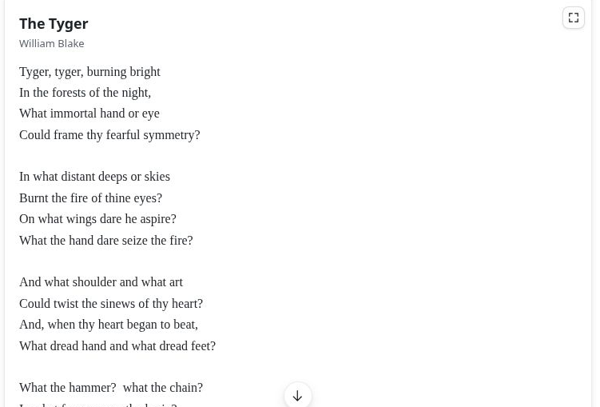
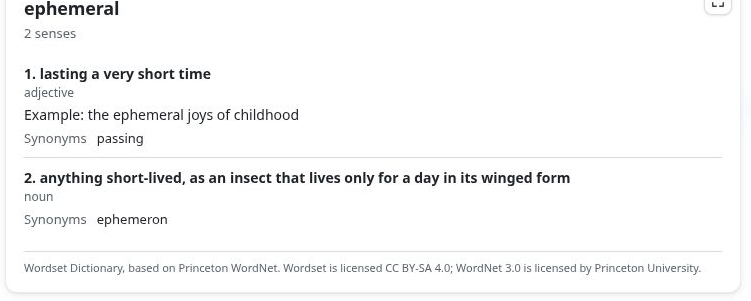
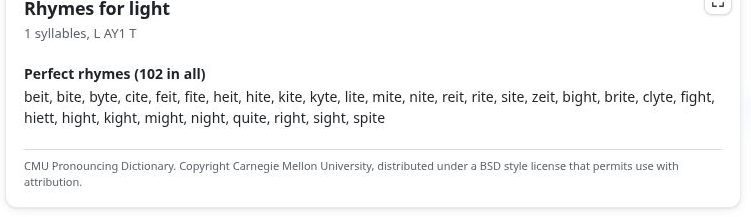

# Poetry Workshop

Find the poem you remember from one line, hear how its ending works, then bring the same attention to a line of your own. Poetry Workshop pairs a searchable library of classic poetry with a pronunciation dictionary and a dictionary that separates each word's senses.

[Connect with Claude, ChatGPT, Muse Code, or Grok](PROVIDERS.md)

> “Find the Dickinson poem with ‘a thing with feathers’ in it and show me what the rhyme does in the first stanza.”

> “My line is ‘At dusk the cattle crossed the broken stile.’ Give me two endings that rhyme with *stone* and keep the ten syllable shape.”

## Use it in Claude Code

```sh
claude plugin marketplace add OpZero-sh/plugins
claude plugin install poetry-workshop@opzero
```

All three connections are public and work without sign in. The word or line used in a lookup goes to the corresponding hosted service.

## What is included

### Skills

| Skill | Use it for |
| --- | --- |
| `/poetry-workshop:read-a-poem` | Finding a classic poem by title, poet or a remembered line, showing its text, and a close reading tied to the words on the page. |
| `/poetry-workshop:poem-of-the-day` | One poem for today or for any date, optionally by a chosen poet and within a length limit, with a short way in. |
| `/poetry-workshop:workshop-a-line` | Revising a line or stanza of your own for rhyme, syllable count, meter or word choice. Returns two or three alternatives with checked counts and the trade each one makes. |
| `/poetry-workshop:rhyme-and-meter` | Rhymes and near rhymes for a word, syllable counts for a line or a haiku, where the stress falls, whether two words rhyme, and scanning a line. |
| `/poetry-workshop:find-the-right-word` | Definitions sense by sense, synonyms grouped by sense, and words that begin with given letters for alliteration or an acrostic. |

Each skill keeps its reference notes beside it: library coverage and search behaviour, terms for sound and structure, how the pronunciation data is written, meter and scansion, the requirements of common forms, a revision template and dictionary notes.

### Agent

**verse-editor** takes a line with several constraints at once, such as a rhyme, a count and a fixed image, and returns at most three revisions with verified syllable counts and rhyme sounds. It can call only the six read only sound and word lookups, and it sends them single words or one line at a time.

### Hooks

None. Every tool in this plugin is read only, so there is nothing to guard.

## Connections and data sources

| Connection | What it adds | Source |
| --- | --- | --- |
| [Classic Poetry](https://classic-poetry.mcp.opzero.sh/) | Searches by poet, title or line, retrieves the chosen poem, lists the poets and picks a poem for a date. | The PoetryDB collection of public domain poetry |
| [Rhyme Finder](https://rhyme-finder.mcp.opzero.sh/) | Finds rhymes by sound and checks syllables and stress. | The CMU Pronouncing Dictionary |
| [Open Dictionary](https://open-dictionary.mcp.opzero.sh/) | Separates definitions and synonyms by sense and lists words by their opening letters. | The Wordset dictionary, based on WordNet |

OpZero publishes this plugin and runs the three services. It is not affiliated with, sponsored by or endorsed by PoetryDB, Carnegie Mellon University, Wordset or WordNet.

Limits worth knowing:

- The poetry library is a fixed set of older poets. Most twentieth century and all contemporary poets are absent, and texts are older transcriptions that can differ from modern editions.
- Pronunciations are modern North American English. Other accents and older pronunciations can rhyme and count differently, and your own ear decides.
- The dictionary is a modern general one. A word or a sense can be missing, and it has no etymology or dates.

## What the plugin runs, sends and fetches

- **Three remote MCP servers:** `https://classic-poetry.mcp.opzero.sh/mcp`, `https://rhyme-finder.mcp.opzero.sh/mcp` and `https://open-dictionary.mcp.opzero.sh/mcp`. A request carries only the tool arguments: search words, a title or poet, a date, or the word or line being looked up. No sign in is used. Each service states that requests are not stored.
- **Your own drafts.** When you workshop a line, the words or the single line being checked are sent to the rhyme and dictionary services. The skills tell Claude not to send a whole poem, its title or your name.
- **No hooks, no local server and no install step.** Nothing in the plugin runs a program on your machine.
- **Two optional scripts** for people working from a checkout. Claude does not run them and the plugin does not need them. They are not in this repository. They live in the catalog repository, [OpZero-sh/plugins](https://github.com/OpZero-sh/plugins).
  - The catalog's `tools/build_openai.py` builds the ZIP packages for ChatGPT and Codex from this repository's skills, license, the product icon and `integrations/openai`. It reads local files, writes ZIP files to the folder you name and makes no network request.
  - The catalog's `tools/grok_example.py` prepares a request to the xAI API that points Grok at the same MCP servers, using the list in `integrations/grok-servers.json`. With `--dry-run` it prints the request and contacts nothing. Without it, the script reads `XAI_API_KEY` and the optional `XAI_MODEL` from your environment and sends your question to `https://api.x.ai/v1/responses`. That happens only when you run the script yourself.

## In use

Examples from the connected services in Claude.






